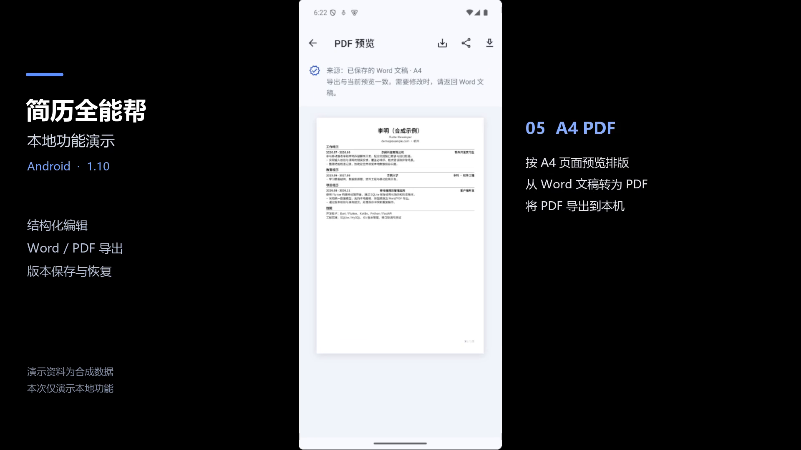
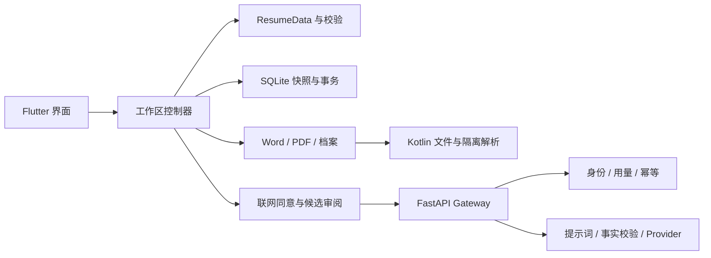

# 简历全能帮 · Resume All-in-One

本地优先的 Android 简历应用。Flutter/Dart 构建界面与业务模型，SQLite 保存不可变版本，Kotlin 处理 Android 文件交付和隔离解析，Python/FastAPI 提供可选的账号与 AI Gateway。

这是一个独立开发实践项目，公开源码用于展示设计、实现与测试过程。代码基于 1.10 / Android code41；公开副本使用示例联系方式，不包含作者云端配置、签名密钥、个人材料或旧开发历史。它不是现网 APK 的逐字节构建副本。

## 演示



截图来自 1.10 的实际模拟器演示，全部简历资料为合成数据。

## 实现范围

| 范围 | 实现 |
| --- | --- |
| 本地编辑 | 基本信息、工作、教育、项目、技能等结构化区段；可选证件照 |
| 版本与恢复 | SQLite 事务追加内容快照；版本冲突检测；历史恢复追加新版本 |
| 文件处理 | 文本、Word、PDF 导入；Word 文稿编辑；A4 PDF 预览、导出及系统分享 |
| 账号 | 可选 Gateway 的短信验证、会话、密码恢复及权益；本地功能无需账号 |
| 受约束 AI | 意图归一与提示词编译、结构化输出校验、事实守卫、候选审阅后确认写入 |
| 费用与失败 | 幂等操作记录、未知结果恢复、可配置调用策略和供应商边界 |

云同步属于实验模块，生产开关关闭。支付、商业运营和应用商店上架不属于已完成能力。

## 设计与代码入口



- [应用装配](apps/client/lib/main.dart)。
- [工作区控制器](apps/client/lib/src/resume_workspace_controller.dart)：编辑、导出、历史和远程候选流程。
- [resume_domain](packages/resume_domain)：领域模型与输入校验。
- [local_storage](packages/local_storage)：Drift/SQLite、迁移与不可变历史。
- [document_io](packages/document_io)：文档、档案解析及排版。
- [agent_protocol](packages/agent_protocol)、[agent_runtime](packages/agent_runtime)、[model_router](packages/model_router)、[entitlements](packages/entitlements)：协议、候选确认、路由与权益模型。
- [agent_gateway](services/agent_gateway)：账号、受约束 Agent、用量及供应商适配。
- [Android 原生模块](apps/client/android/app/src/main/kotlin/com/resumeallinone/resume_all_in_one_client)：ContentProvider、图片及文档处理。

## 本地运行

项目工具链：Flutter 3.47.5（含 Dart）、JDK 25.0.2、Android SDK。Android Studio 打开 apps/client。

```sh
cd apps/client
flutter pub get --enforce-lockfile
flutter run -d <android-device-id>
```

默认构建不配置 Gateway 地址，本地编辑与文件功能可独立使用。联网流程需要部署自己的后端并配置 HTTPS、短信和模型凭据；不提供作者生产入口。法律文本中的运营者和联系方式是公开示例，部署者须按实际服务维护。

后端合成模式、依赖与数据库说明见 [Gateway README](services/agent_gateway/README.md)。供应商 Key、数据库密码和 Android 签名通过外部配置提供。

## 测试与审查

```sh
cd apps/client
flutter analyze --no-pub
flutter test --no-pub

cd ../../services/agent_gateway
python -m pip install -r requirements-lock.txt
python -m pytest
```

2026-11-23，由未参与开发、未继承开发聊天历史的独立 AI reviewer 检查当前工作树；主负责人另行复核并运行隔离测试。已确认请求边界遗漏、时钟回拨保存、Android 导入等待及协议写入中断恢复等待修复项。范围和验证结果见 [检查状态](REVIEW_STATUS.md)。审查不等同于没有缺陷或可直接部署生产。

## 项目说明

需求、技术选型、云资源配置及真机验收由开发者主导，代码和材料使用 AI 辅助，审查与生成分开进行。仓库保留实际实现、测试与已知限制，不把有源码的模块表述为已经运营。

项目整体暂未添加开源许可证；第三方字体、组件和依赖保留原有许可证及 NOTICE。后续授权方式由维护者明确。
